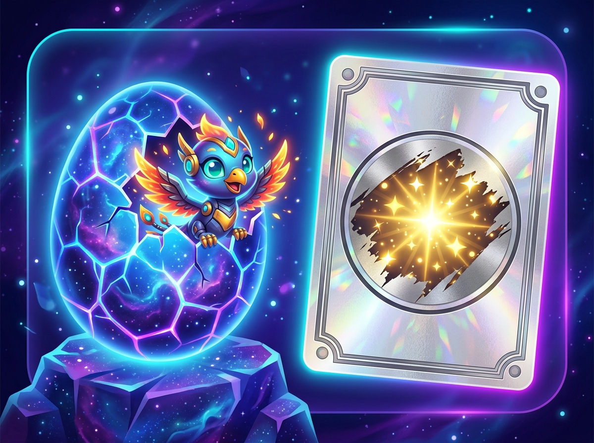
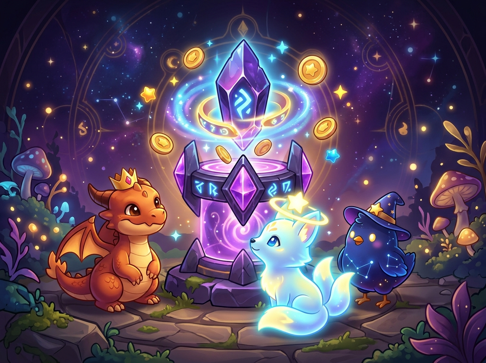
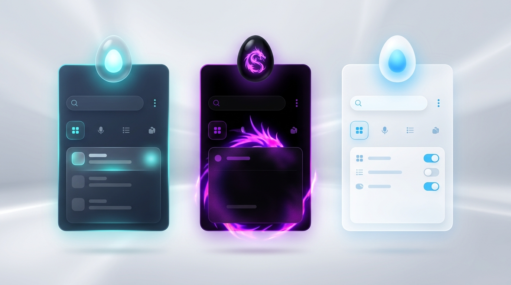

<div align="center">


# EggDecide

**Offline Gamified Decision Maker & Habit Companion for Android**

[](../../releases/latest)
[](CHANGELOG.md)
[](#features)

[Download Global APK](../../releases/latest/download/EggDecide-global.apk) • [All Releases & Tags](../../releases) • [Update Logs](CHANGELOG.md)

</div>

---

## Overview

**EggDecide** turns everyday indecision, boredom, and habit-building into an offline, tactile micro-game. Crack open themed creature eggs, scratch metallic holographic foil cards, track focus sessions with synthesized ambient audio, raise companions in your Pet Sanctuary, and climb streak multipliers to unlock 50 achievement badges.

---

## Download Global APK (GitHub Releases & Tags)

Every push to `main` and every `v*` Git tag automatically builds and publishes a **universal global APK** (`arm64-v8a`, `armeabi-v7a`, `x86`, `x86_64`) compatible with all Android 7.0+ (API 24+) devices worldwide:

| Channel | Link | Notes |
| --- | --- | --- |
| **Latest Global Release APK** | [`EggDecide-global.apk`](../../releases/latest/download/EggDecide-global.apk) | Always points to the newest tagged release |
| **Rolling `global` Tag** | [`releases/tag/global`](../../releases/tag/global) | Permanent global tag updated on every build |
| **All Version Tags (`v*`)** | [`GitHub Releases`](../../releases) | Versioned builds with SHA-256 checksums & release notes |

### How to Install on Android
1. Download **`EggDecide-global.apk`** from the [Latest Release](../../releases/latest) or [`global` tag](../../releases/tag/global).
2. Open the downloaded `.apk` file on your Android phone or tablet.
3. If prompted, allow **Install unknown apps** for your browser or file manager, then tap **Install**.

---

## Visual Tour & Core Features

### 1. Interactive Egg Hatching & Holographic Scratch Cards

<p align="center">
  
</p>

- **3-Tap Organic Egg Hatcher**: Progressive fracture lines, peek animation, synthesized ceramic crack SFX, haptic pulses, and confetti burst.
- **High-Performance Scratch Cards**: GPU-accelerated canvas (`contain: strict`, `will-change: transform`) with grid coverage verification so every swipe feels crisp.
- **Mood Suggestion & Urge Shield**: One-tap suggestions for **Quick**, **Chill**, or **Urge Shield** wins, plus a **Focus Timer**, **Same-Day Reminder**, and **Ambient Soundscapes** (*Rain*, *Space*, *Fire*).

### 2. Pet Sanctuary, Accessories & Mystery Blind Boxes

<p align="center">
  
</p>

- **9 Collectible Egg Skins & Hatchlings**: Cosmic Chick, Baby Fire Drake, Baby Ender Dragon, Golden Sovereign Phoenix, Baby Forest Drake, Frost Griffin, Sunmane Lion Cub, Kitsune Spirit Cub, and Mini Cyber Owl.
- **Mystery Egg Blind Boxes (`65 Coins`)**: Roll for unowned Egg Skins, Pet Accessories, Golden Coin Jackpots (`80–140 Coins`), or Royal XP Feasts.
- **Pet Accessories & Habitat Tiers**: Equip **Lucky Leaf**, **Royal Crown**, **Star Halo**, **Wizard Hat**, or **Cyber Visor** directly onto your pets, and upgrade your Sanctuary from **Cozy Nest** (`+25 XP`) → **Crystal Alcove** (`+35 XP`) → **Celestial Shrine** (`+50 XP`).
- **Daily Quests & 50 Achievement Badges**: Complete 3 daily quests to unlock the **Daily Streak Chest** (`+60 Coins`) and stack your **Streak Coin Multiplier** up to **`2.0x`**.

### 3. Light, AMOLED Black & Midnight Themes with Frosted Glass

<p align="center">
  
</p>

- **3 Theme Modes**: Switch seamlessly between **Midnight**, battery-saving **AMOLED Pure Black**, and crisp **Light Mode** while preserving your equipped Egg Skin accent palette.
- **Frosted Glass, Drifting Gradient Orbs & VFX**: Translucent blurred cards, spring tap micro-animations, and rising `+Coins` floating popups.
- **Offline Save Backup**: Export and import your full progress (`JSON` copy/paste or `.json` file) anytime from **Settings**.
- **Switchable Android Launcher Icons**: Swap between the **Cosmic Egg** and **Ender Dragon** home-screen icons inside Settings.

---

## Update Logs

Recent changes live in **[`CHANGELOG.md`](CHANGELOG.md)**. Highlights from **`v1.2.0`**:
- Light Mode & AMOLED Black surfaces + frosted glassmorphism & animated gradient orbs
- Mystery Egg Blind Boxes (`65 Coins`) & Streak Coin Multiplier (`1.0x`–`2.0x`)
- 5 Pet Accessories & 3 Sanctuary Habitat Tiers
- Floating `+Coins` popups, spring tap micro-animations, and offline JSON Save Backup
- Automated Global APK publishing pipeline across GitHub Releases and Tags

---

## Building Locally & Tagging a Global Release

### Build Universal Global APK Locally
```bash
gradle :app:assembleDebug --no-daemon
# Universal APK output:
# app/build/outputs/apk/debug/app-debug.apk
```

### Triggering a Tagged GitHub Release
Push a semantic version tag (`v*`) to publish a dedicated release with `EggDecide-global.apk` and changelog notes:
```bash
git tag v1.2.0
git push origin v1.2.0
```
Or run **Actions → Build & Release Global APK → Run workflow** manually in GitHub.

---

## Project Structure

```text
.
├── .github/workflows/build-apk.yml   # Builds universal APK & publishes to GitHub Releases + Tags
├── app/
│   ├── build.gradle.kts              # App ID, versionCode (3), versionName (1.2.0), signing configs
│   └── src/main/
│       ├── assets/index.html         # Bundled WebView UI (kept in sync with root /index.html)
│       ├── java/com/example/MainActivity.kt
│       └── res/                      # Adaptive launcher icons & Android resources
├── docs/images/                      # README visual showcase photos
├── CHANGELOG.md                      # Versioned update logs
├── README.md                         # Project documentation & release links
└── index.html                        # Primary app source
```
